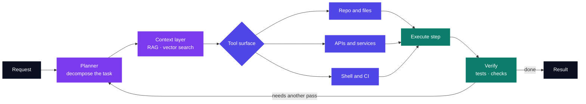
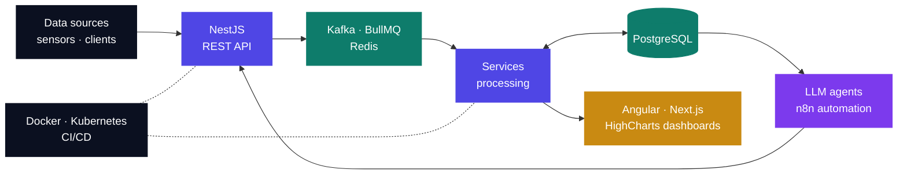
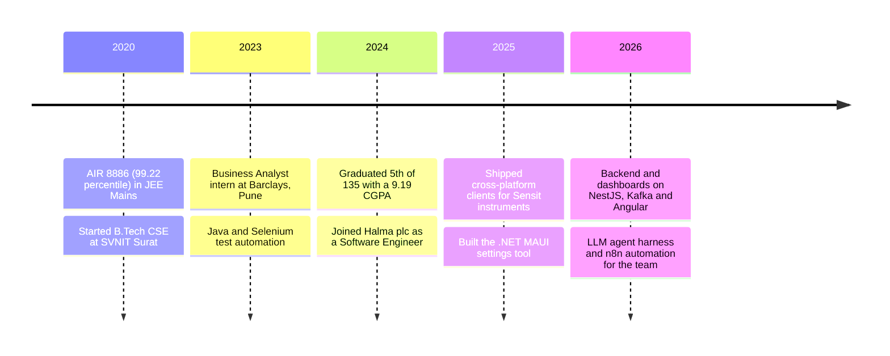
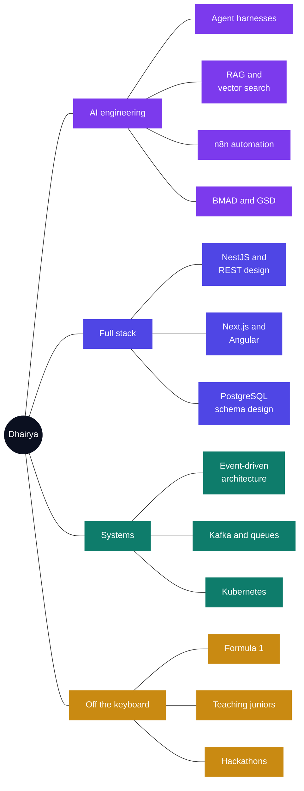

<!--
  Dhairya Oza · GitHub profile README
  Lives at github.com/Dhairya-007/Dhairya-007 — this file renders on the profile page.

  Positioning: full-stack engineer who builds AI into the stack.
  Frontend and backend lead; the cross-platform client work sits further down.

  Palette (keep these consistent if you edit):
    deep navy #0B1020
    indigo    #4F46E5
    violet    #7C3AED
    teal      #0E7C6B

  THINGS TO FILL IN LATER
    - The AI section is the thinnest part of the public story. Ship 2-3 AI repos
      (agent harness, a RAG service, an n8n workflow pack) and link them here.
    - Push Siddheshwari Investment to a public repo and link it in the table.
    - Pin: citrine-growth, detonator, portfolio, DSA, GushWorks
      (profile -> Customize your pins).
-->

  

  

  
  
  

---

## 👋 About me

I'm a **full-stack engineer** at **Halma plc**, building the whole path: PostgreSQL schemas and NestJS services at the back, Kafka and Redis in the middle, Angular and Next.js dashboards at the front, and Docker/Kubernetes underneath it all.

The half I'm most interested in right now is **AI in the engineering loop**. I've built a custom **LLM agent harness** and **n8n** automation that my team uses daily, and I work with RAG, vector search and agentic frameworks like BMAD and GSD. Not models — systems: the orchestration, the tool layer, the retrieval, and the glue that makes an agent useful instead of impressive.

I studied Computer Science at **SVNIT Surat**, graduating in 2024 ranked 5th of 135 with a 9.19 CGPA.

  
  
  
  

---

## 🏗️ Full-stack engineering

### 🌐 Sensor data platform · `Angular` `NestJS` `PostgreSQL` `Kafka`

`Halma plc` &nbsp; `2024 – present`

A platform that ingests high-volume sensor data and puts it in front of customers as live dashboards. I work across the whole stack on it.

**Backend**
- Engineered the **REST API surface** and backend services on **NestJS**.
- Built the ingestion path with **Apache Kafka** event streaming, **Redis** caching and **BullMQ** job queues, so high-volume sensor data lands reliably instead of dropping under burst load.
- Designed for scale and fault tolerance — the data arrives faster than any single service wants to handle.

**Frontend**
- Built real-time **HighCharts** visualizations on Angular, including interactive **wind-rose plots** and correction dashboards, so customers can read live field data at a glance.

**Infrastructure**
- Containerized services with **Docker**, deployed on **Kubernetes**, and wired up **CI/CD pipelines** for scalable, fault-tolerant releases.

**Performance**
- Refactored data-intensive modules and optimized LiteDB queries in a legacy UWP desktop app — reports and grids load up to **75% faster**.

---

## 🤖 AI and agentic engineering

### 🧠 LLM agent harness and workflow automation

`Halma plc`

The part of my work I'd happily talk about all day. I build the systems around models, not the models themselves.

- Built a **custom LLM agent harness** for internal use — the orchestration layer that gives a model a tool surface, a context budget and a place to fail safely.
- Built internal automation on **n8n** workflow orchestration, wiring engineering tasks into repeatable pipelines.
- Researched and integrated **agentic AI development frameworks** — **BMAD** and **GSD** — into the team's daily engineering workflow.

**What I work with:** LLM APIs (Claude, OpenAI) · prompt engineering · **RAG** · vector search · agentic workflows · tool/function calling · n8n

  
  
  
  
  

### How I think about agent systems

---

## 🧩 Full-stack projects

| Project | What it is | Stack | Links |
| --- | --- | --- | --- |
| **Citrine Growth** | A digital agency platform — marketing site plus a full admin panel, with dual light/dark theming throughout. | Next.js 14 · NestJS · Prisma · PostgreSQL | [Code](https://github.com/Dhairya-007/citrine-growth) |
| **Detonate the Bomb** | A browser puzzle game: 50 hand-built levels, instruction-driven gameplay, timer system, scoring and level progression, all client-side. | Next.js · TypeScript · CSS3 | [Live](https://detonatebomb.netlify.app/) · [Code](https://github.com/Dhairya-007/detonator) |
| **Portfolio** | A single-page portfolio built as a Formula 1 racing dashboard — 10+ custom animations, dynamic gauges, interactive navigation, responsive to phone width. | Next.js · TypeScript · CSS animations | [Live](https://dhairyaoza007.netlify.app/) · [Code](https://github.com/Dhairya-007/portfolio) |
| **Siddheshwari Investment** | A business site for an investment firm: 10+ content sections, tuned for load performance and cross-browser support. | Angular · TypeScript · Netlify | [Live](https://siddheshwariinvestment.netlify.app/) |
| **DSA** | Where my data structures and algorithms practice lives. | Java | [Code](https://github.com/Dhairya-007/DSA) |

---

## 🔌 The shape of what I build

End to end, most of my work is this path:

---

## 📱 Also: cross-platform client work

The front end of that platform isn't only a browser. At Halma I also lead the mobile and desktop clients that talk to the hardware directly:

- **Flutter app** for Sensit gas-detection instruments — a multi-protocol connectivity layer (BLE, Wi-Fi, LAN, serial), an **offline-first ObjectBox store** with bidirectional cloud sync and automatic reconciliation on reconnect, real-time charts, Gantt timeline views, multi-template report generation, firmware updates and calibration workflows. I shipped the foundational MVP.
- **.NET MAUI settings application** — configures ~50 instrument parameters through a guided UI, packaged as byte arrays written over BLE. Removed **over 99%** of manual configuration effort.
- **React Native app** — BLE data download, SQLite persistence and cloud sync across Android and iOS from one shared codebase, **40% less** development effort.

### 🏦 Earlier: test automation at Barclays

`Business Analyst (BA4) Intern` &nbsp; `Pune, 2023`

Built an automated testing framework with **Java** and **Selenium WebDriver** that raised coverage across critical workflows by **90%**, and wired it into **Jenkins** to run on every commit.

---

## 🧰 Tech I use

**Frontend**

  

HighCharts · React Native · Responsive and cross-browser work

**Backend**

  

REST APIs · Microservices · Message queues · BullMQ · ASP.NET

**Data and messaging**

  

SQL Server · LiteDB · ObjectBox · Vector search

**AI and LLM**

  
  
  

Agent harness · RAG · Vector search · Prompt engineering · Tool calling · BMAD / GSD

**Cloud and DevOps**

  

Azure DevOps · CI/CD · Flutter and .NET MAUI for client work

---

## 🗺️ How I got here

---

## 🧠 What's on my mind

---

## 🌱 Right now

- 🤖 **Building agentic tooling into daily engineering.** n8n orchestration, a custom LLM agent harness, and frameworks like BMAD and GSD — the goal is an agent that reliably finishes a task, not one that demos well.
- 🔍 **Going deeper on RAG and retrieval.** Chunking strategies, vector search, and how much context is actually worth paying for.
- ⚙️ **Scaling the backend.** Event-driven architecture, concurrency and fault tolerance, for when sensor data arrives faster than one service can handle.
- 🧩 **Keeping fundamentals sharp** in [my DSA repo](https://github.com/Dhairya-007/DSA).

---

## 🏆 Achievements

| | |
| --- | --- |
| 🎯 **JEE Mains 2020** | All India Rank **8886** — 99.22 percentile among 1.1 million candidates |
| 🎯 **JEE Advanced 2020** | All India Rank **~10,000** — 95+ percentile among 1.6 lakh candidates |
| 🎓 **SVNIT Surat, 2024** | Ranked **5th of 135** in B.Tech Computer Science and Engineering, 9.19/10 CGPA |
| 🧑‍🏫 **ACM NIT Surat** | Executive — organized hackathons and ran technical sessions for juniors |
| 💻 **MLSA NIT Surat** | Junior Developer — built event websites and supported technical events |

---

## 🤝 Let's talk

Happy to talk about full-stack architecture, event-driven backends, or putting LLM agents somewhere they actually earn their keep.

📫 [ozadhairya73@gmail.com](mailto:ozadhairya73@gmail.com) · [LinkedIn](https://www.linkedin.com/in/dhairya-oza-7723b2200/) · [Portfolio](https://dhairyaoza007.netlify.app)

  

