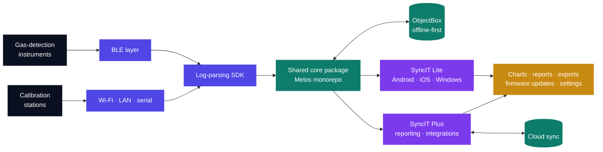
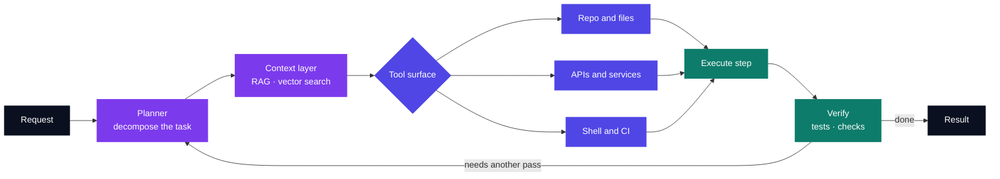
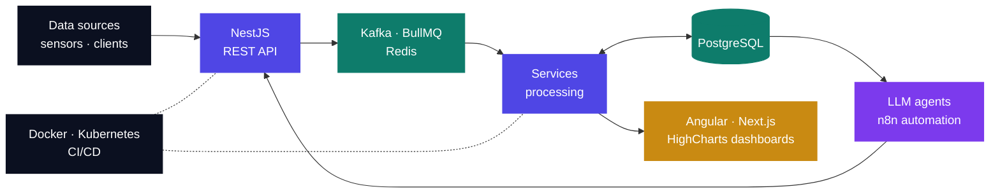
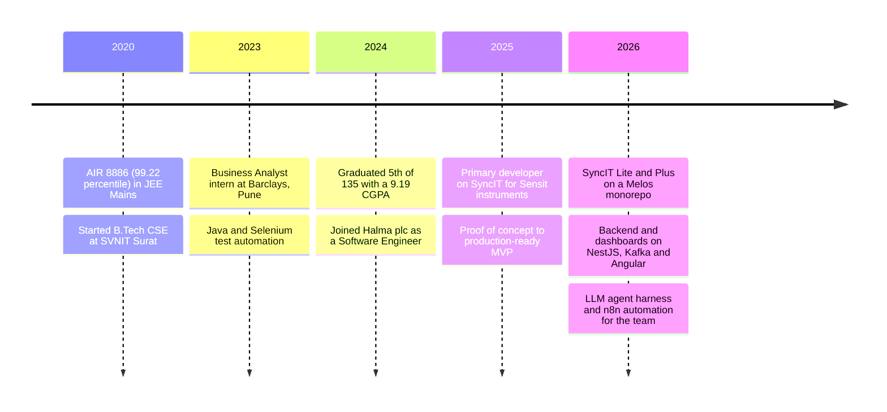
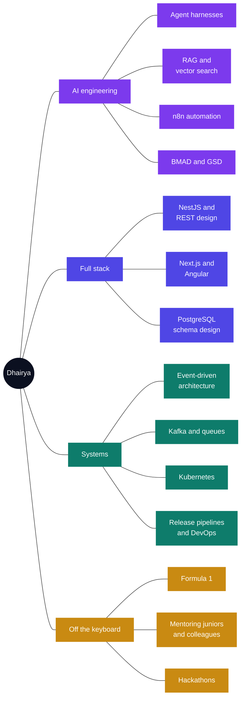

<!--
  Dhairya Oza · GitHub profile README
  Lives at github.com/Dhairya-007/Dhairya-007 — this file renders on the profile page.

  Positioning: full-stack engineer who builds AI into the stack.
  Frontend and backend lead; SyncIT (the cross-platform Sensit product) sits right after it.

  Palette (keep these consistent if you edit):
    deep navy #0B1020
    indigo    #4F46E5
    violet    #7C3AED
    teal      #0E7C6B

  THINGS TO FILL IN LATER
    - Push Siddheshwari Investment to a public repo and link it in the table.
    - Pin these six: agent-harness, rag-service, citrine-growth, detonator,
      portfolio, DSA (profile -> Customize your pins).
    - An n8n workflow pack would round out the AI section.
    - Add a short "currently learning" line once the agent harness is public.
-->

  

  

  
  
  

---

## 👋 About me

I'm a **full-stack engineer** at **Halma plc**, building the whole path: PostgreSQL schemas and NestJS services at the back, Kafka and Redis in the middle, Angular and Next.js dashboards at the front, and Docker/Kubernetes underneath it all.

The half I'm most interested in right now is **AI in the engineering loop**. I've built a custom **LLM agent harness** and **n8n** automation that my team uses daily, and I work with RAG, vector search and agentic frameworks like BMAD and GSD. Not models — systems: the orchestration, the tool layer, the retrieval, and the glue that makes an agent useful instead of impressive.

The other half of my work is hardware-facing. I'm the primary developer on **SyncIT**, the application that manages Sensit's gas-detection instruments over BLE, Wi-Fi, LAN and serial, on Android, iOS and Windows from one Flutter codebase.

I also mentor juniors and colleagues on the codebase, and work with the project manager and engineering manager in **Wrike** on task breakdown, sizing and distribution.

I studied Computer Science at **SVNIT Surat**, graduating in 2024 ranked 5th of 135 with a 9.19 CGPA.

  
  
  
  
  
  

---

## 🏗️ Full-stack engineering

### 🌐 Sensor data platform · `Angular` `NestJS` `PostgreSQL` `Kafka`

`Halma plc` &nbsp; `2024 – present`

A platform that ingests high-volume sensor data and puts it in front of customers as live dashboards. I work across the whole stack on it.

**Backend**
- Engineered the **REST API surface** and backend services on **NestJS**.
- Built the ingestion path with **Apache Kafka** event streaming, **Redis** caching and **BullMQ** job queues, so high-volume sensor data lands reliably instead of dropping under burst load.
- Designed for scale and fault tolerance — the data arrives faster than any single service wants to handle.

**Frontend**
- Built real-time **HighCharts** visualizations on Angular, including interactive **wind-rose plots** and correction dashboards, so customers can read live field data at a glance.

**Infrastructure**
- Containerized services with **Docker**, deployed on **Kubernetes**, and wired up **CI/CD pipelines** for scalable, fault-tolerant releases.

**Performance**
- Refactored data-intensive modules and optimized LiteDB queries in a legacy UWP desktop app — reports and grids load up to **75% faster**.

---

## 📱 SyncIT · instrument management platform

### 🛰️ Cross-platform product for gas-detection instruments · `Flutter` `Dart` `Melos` `ObjectBox`

`Sensit Technologies · Halma India` &nbsp; `2025 – present` &nbsp; `Android · iOS · Windows`

  
  
  
  
  
  

  
  
  
  

<table>
  <tr>
    <td align="center"><b>−99%</b> manual production effort removed</td>
    <td align="center"><b>30–35%</b> faster after schema and query work</td>
    <td align="center"><b>50</b> instrument settings pushed automatically</td>
    <td align="center"><b>4</b> transports: BLE, Wi-Fi LAN, serial</td>
    <td align="center"><b>3</b> platforms from one codebase</td>
    <td align="center"><b>5</b> older apps merged into SyncIT Lite and Plus</td>
    <td align="center"><b>25–30</b> person team across 3 countries</td>
  </tr>
</table>

[Sensit](https://sensit-tech.com/gas-leak-detection-software/) has made gas-detection instruments for utilities, firefighters and hazmat teams for over 40 years. **SyncIT** is its next-generation instrument management platform. It retired **5 older Sensit apps**, with all their functions consolidated into SyncIT Lite and SyncIT Plus.

I'm the **primary developer** on it, working with a **25–30 person team** across software, firmware, hardware, QA, project management and marketing, split between **Ahmedabad**, **Valparaiso (Indiana)** and **Bolzano (Italy)**.

**What I did**

- Took SyncIT from a **proof of concept to a production-ready MVP**, and have kept evolving it since through new features, architectural improvements and client-driven changes.
- **Retired 5 older apps** and moved all their functions into SyncIT Lite and Plus.
- Structured it as a **Melos monorepo** with two product variants on a shared core package and a dedicated **log-parsing SDK**.
- Built the **device communication modules** — **BLE** for gas-detection instruments, and **Wi-Fi, LAN and serial** for calibration stations — covering log download, parsing, visualization, firmware update workflows and multi-format export.
- Suggested and built a **settings application for three instruments**, with an automated BLE update flow across **50 settings**. Working with the firmware team, this cut manual production effort by about **99%**.
- **Performance:** improved app performance by about **30–35%** by optimizing the database schema and queries.
- **Robustness:** built the **offline-first ObjectBox store** with bidirectional cloud sync and automatic reconciliation on reconnect, for reliable operation in low-connectivity field environments.
- Built the data-heavy screens on top of it: real-time charts, Gantt timeline views and multi-template report generation.
- Reworked the app's **UI, navigation flow and data visualization**, creating the wireframes with the engineering manager.
- Built **Windows-scheduled reporting** for LAN-connected devices, with customizable export configurations.
- **Own the full release pipeline**: build generation, versioning, packaging and distribution on every platform.

**Beyond the code**

I joined Halma as an intern in January 2024 and have been the primary developer on SyncIT since 2025.

- **Spotted a production bottleneck and removed it.** I proposed the settings application and built it with the firmware team. Manual production effort dropped by about **99%**.
- **Own releases on 3 platforms.** Builds, versioning, packaging and distribution for Android, iOS and Windows, with **Azure DevOps** in the toolchain.
- **Primary developer for a 25–30 person team.** That means working with **6 disciplines in 3 countries**: software, firmware, hardware, QA, project management and marketing.
- **Keep delivery organised in Wrike.** I create tasks, size them, distribute them across the team and track them through to release.
- **Mentor juniors and colleagues** on the codebase and help them get unblocked.
- **Brought agentic tooling into daily engineering.** I built a custom LLM agent harness and **n8n** automation for the team, and integrated **BMAD** and **GSD** into its workflow.

| Variant | What it is |
| --- | --- |
| **SyncIT Lite** | Offline-first, for field evaluation |
| **SyncIT Plus** | Cloud sync, advanced reporting and premium integrations |

**Stack:** Flutter · Dart · Melos · ObjectBox · BLE · Wi-Fi, LAN and serial · Azure DevOps CI/CD · Wrike · n8n · Claude Code

  
  
  
  
  

---

## 🤖 AI and agentic engineering

### 🧠 LLM agent harness and workflow automation

`Halma plc`

The part of my work I'd happily talk about all day. I build the systems around models, not the models themselves.

- Built a **custom LLM agent harness** for internal use — the orchestration layer that gives a model a tool surface, a context budget and a place to fail safely.
- Built internal automation on **n8n** workflow orchestration, wiring engineering tasks into repeatable pipelines.
- Researched and integrated **agentic AI development frameworks** — **BMAD** and **GSD** — into the team's daily engineering workflow.

**What I work with:** LLM APIs (Claude, OpenAI) · prompt engineering · **RAG** · vector search · agentic workflows · tool/function calling · n8n

  
  
  
  
  

### 📦 Open source

The work above lives in a private codebase, so here are the same ideas, in public and runnable.

| Repo | What it is | Built with |
| --- | --- | --- |
| **[agent-harness](https://github.com/Dhairya-007/agent-harness)** | A typed agent harness for Claude. The loop is the easy part — this is the rest: tool inputs validated before they run, approval gates over parsed arguments, a context budget that clears old tool output, a verification pass that can send the model back, and distinct errors for refusal, truncated tool input and context overflow. 39 tests, no network. | TypeScript · Zod · Anthropic SDK |
| **[rag-service](https://github.com/Dhairya-007/rag-service)** | Grounded document Q&A. Hybrid BM25 + dense retrieval fused by rank, a NestJS API and a Next.js UI. Retrieval is a *tool the model calls repeatedly*, not a prompt prefix, and an answer that cites nothing is rejected and sent back. 52 tests. | NestJS · Next.js · TypeScript · agent-harness |

### How I think about agent systems

---

## 🧩 Full-stack projects

| Project | What it is | Stack | Links |
| --- | --- | --- | --- |
| **rag-service** | Grounded document Q&A — hybrid retrieval, a NestJS API and a Next.js UI, with answers that cite their sources. | NestJS · Next.js · TypeScript | [Code](https://github.com/Dhairya-007/rag-service) |
| **agent-harness** | A typed agent harness for Claude: validated tool inputs, approval gates, context budgeting and a readable trace. | TypeScript · Zod · Anthropic SDK | [Code](https://github.com/Dhairya-007/agent-harness) |
| **Citrine Growth** | A digital agency platform — marketing site plus a full admin panel, with dual light/dark theming throughout. | Next.js 14 · NestJS · Prisma · PostgreSQL | [Code](https://github.com/Dhairya-007/citrine-growth) |
| **Detonate the Bomb** | A browser puzzle game: 50 hand-built levels, instruction-driven gameplay, timer system, scoring and level progression, all client-side. | Next.js · TypeScript · CSS3 | [Live](https://detonatebomb.netlify.app/) · [Code](https://github.com/Dhairya-007/detonator) |
| **Portfolio** | A single-page portfolio built as a Formula 1 racing dashboard — 10+ custom animations, dynamic gauges, interactive navigation, responsive to phone width. | Next.js · TypeScript · CSS animations | [Live](https://dhairyaoza007.netlify.app/) · [Code](https://github.com/Dhairya-007/portfolio) |
| **Siddheshwari Investment** | A business site for an investment firm: 10+ content sections, tuned for load performance and cross-browser support. | Angular · TypeScript · Netlify | [Live](https://siddheshwariinvestment.netlify.app/) |
| **DSA** | Where my data structures and algorithms practice lives. | Java | [Code](https://github.com/Dhairya-007/DSA) |

---

## 🔌 The shape of what I build

End to end, most of my work is this path:

---

## 📱 Other instrument clients at Halma

Two more clients for the same instruments:

- **.NET MAUI settings application** — the app behind the 99% figure above. It configures ~50 instrument parameters through a guided UI, packaged as byte arrays and written to the instrument's Customer Profile region over BLE.
- **React Native app** — BLE data download, SQLite persistence and cloud sync across Android and iOS from one shared codebase, **40% less** development effort.

---

## 🏦 Before Halma: test automation at Barclays

`Business Analyst (BA4) Intern` &nbsp; `Pune, 2023`

Built an automated testing framework with **Java** and **Selenium WebDriver** that raised coverage across critical workflows by **90%**, and wired it into **Jenkins** to run on every commit.

---

## 🧰 Tech I use

**Frontend**

  

HighCharts · Flutter · React Native · .NET MAUI · Responsive and cross-browser work

**Backend**

  

REST APIs · Microservices · Message queues · BullMQ · ASP.NET

**Data and messaging**

  

SQL Server · LiteDB · ObjectBox · Vector search · Melos monorepos

**AI and LLM**

  
  
  

Agent harness · RAG · Vector search · Prompt engineering · Tool calling · BMAD / GSD

**Cloud and DevOps**

  

Azure DevOps · CI/CD · Multi-platform release pipelines (Android, iOS, Windows) · Wrike · Task planning and distribution

---

## 🗺️ How I got here

---

## 🧠 What's on my mind

---

## 🌱 Right now

- 🤖 **Building agentic tooling into daily engineering.** n8n orchestration, a custom LLM agent harness, and frameworks like BMAD and GSD — the goal is an agent that reliably finishes a task, not one that demos well.
- 🔍 **Going deeper on RAG and retrieval.** Chunking strategies, hybrid search and rank fusion, and how much context is actually worth paying for — most of it ends up in [rag-service](https://github.com/Dhairya-007/rag-service).
- 📡 **Growing SyncIT past its MVP.** Two product variants on one Melos monorepo, a shared core package, a log-parsing SDK, and the device communication layer underneath both.
- ⚙️ **Scaling the backend.** Event-driven architecture, concurrency and fault tolerance, for when sensor data arrives faster than one service can handle.
- 🌍 **Contributing upstream, one CI blind spot at a time.** 50 changes merged into Apache Camel, Elasticsearch,
  Quarkus, Home Assistant, typeshed, the PEPs, Netty, Micronaut, more-itertools, drift and the Dart SDK repos — each one
  a defect the project's own linters and test suites could not reach — and 40 more in review.
- 🧩 **Keeping fundamentals sharp** in [my DSA repo](https://github.com/Dhairya-007/DSA).

---

## 🌍 Open source contributions

I hunt one class of bug on purpose: the kind a project's CI **structurally cannot catch**. A default hidden behind `**kwargs` that `stubtest` has no parameter to compare against. A log line whose placeholders outnumber its arguments. A hand-written catalog entry that drifts from the enum it describes. A format string that throws the moment debug logging is switched on. Linters do not look there, so the defects sit in released code for years.

  
  
  

> Merged into **Apache Camel**, **Elasticsearch**, **Quarkus**, **Home Assistant**, **CPython's PEPs**, **typeshed**, **Netty**, **Micronaut**, **more-itertools**, **drift** and Google's **shelf** and **native** — 50 changes, every one a defect their own tooling could not see. Status below is live as of 12 Nov 2026.

### ☕ Java · [Apache Camel](https://github.com/apache/camel), [Elasticsearch](https://github.com/elastic/elasticsearch), [Quarkus](https://github.com/quarkusio/quarkus), [Netty](https://github.com/netty/netty), [Micronaut](https://github.com/micronaut-projects/micronaut-core)

| Merged | What it fixed |
| --- | --- |
| ✅ [elasticsearch#165058](https://github.com/elastic/elasticsearch/pull/165058) | Two log statements with more `{}` placeholders than arguments, so the message printed a literal `{}` where the value should have been — in `TransportService` and the ILM `SetSingleNodeAllocateStep`. Nothing fails a build over a log line, so they are invisible until someone reads the output. |
| ✅ [quarkus#58229](https://github.com/quarkusio/quarkus/pull/58229) | `TestRegistryClient.clearCache` built its message with `%d` for a `Path`, so the only thing that could come out of that line was `IllegalFormatConversionException` — thrown from the error handler, replacing the real failure. |
| ✅ [camel#29649](https://github.com/apache/camel/pull/29649) | Seven argument checks that name something other than the value they check, so `IllegalArgumentException` sent the caller to the wrong option. One pair in camel-as2 gave away the copy: the same two wrong literals on the same line numbers of a sibling class. |
| ✅ [camel#29650](https://github.com/apache/camel/pull/29650), [#29641](https://github.com/apache/camel/pull/29641) | Javadoc blocks separated from the member they document: a field inserted between a block and its target orphans the earlier block, and Javadoc keeps only the last. 22 of them across core and camel-jbang, including one whose description and `@param` tags had drifted into separate blocks, so only the tags survived. |
| ✅ [camel#29647](https://github.com/apache/camel/pull/29647) | `@param` tags naming arguments the method does not have, plus duplicated words in Javadoc — on members where `-Xdoclint` does not run. |
| ✅ [camel#29646](https://github.com/apache/camel/pull/29646) | Three option descriptions that describe something other than the option, found by reading the catalog JSON rather than the source. |
| ✅ [camel#29570](https://github.com/apache/camel/pull/29570) | Four documented header names no component declares: infinispan's `CamelInfinispanLifespanTimeUnit` (the real one is `CamelInfinispanTimeUnit`), keycloak's `CamelKeycloakUserPasswordTemporary`, and two javadoc references in langchain4j-embeddingstore. A wrong header name is silently ignored at runtime. |
| ✅ [camel#29569](https://github.com/apache/camel/pull/29569) | `NowSearchTerm` redeclared the inherited `ComparisonTerm.comparison`, so `super.equals` compared a field that is always `0`: `equals` ignored both `comparison` and `offset` while `hashCode` used `comparison`, giving equal terms different hash codes. |
| ✅ [camel#29568](https://github.com/apache/camel/pull/29568) | Three fluent setters on `CyberArkVaultConfigurationProperties` called themselves instead of their setter, so configuring an API key, the SSL flag or a certificate path threw `StackOverflowError`. |
| ✅ [camel#29550](https://github.com/apache/camel/pull/29550), [#29645](https://github.com/apache/camel/pull/29645) | 22 misspellings in option and header descriptions across 17 components, each fixed at the annotation or setter javadoc the generator reads and propagated by hand to every generated copy — the component JSON, both catalog copies and the DSL builders. |
| ✅ [camel#29642](https://github.com/apache/camel/pull/29642), [#29644](https://github.com/apache/camel/pull/29644), [#29648](https://github.com/apache/camel/pull/29648), [#29651](https://github.com/apache/camel/pull/29651) | Camel's CI has no spell checker at all. Four sweeps over component docs, test comments, the user manual and the READMEs — with the intentional misspellings left alone, since a line like ``camel ps --sort=nmae`` is demonstrating an unknown key. |
| ✅ [camel#29543](https://github.com/apache/camel/pull/29543) | camel-docling sets four async-status headers from string literals, so they were missing from `DoclingHeaders`, the catalog and the headers table. Declares them and asserts them in the async tests. |
| ✅ [camel#29542](https://github.com/apache/camel/pull/29542) | camel-ibm-watsonx-ai read `CamelAzureStorageBlobName` to name a streamed blob, but camel-azure-storage-blob sets `CamelAzureStorageBlobBlobName`, so the Azure fallback never matched. With a unit test for the resolution order. |
| ✅ [camel#29541](https://github.com/apache/camel/pull/29541) | Three headers (aws2-ddb, mongodb, smpp) documented with the text of the header declared next to them, one of them the opposite of what the code sets. |
| ✅ [camel#29539](https://github.com/apache/camel/pull/29539) | camel-crypto's `certificateName` was described as a `PrivateKey` reference; the setter looks up a `Certificate`. |
| ✅ [camel#29538](https://github.com/apache/camel/pull/29538) | camel-mail's `ignoreUriScheme` carried `ignoreUnsupportedCharset`'s description across six schemes, the catalog and both DSLs. |
| ✅ [camel#29492](https://github.com/apache/camel/pull/29492) | camel-seda's `defaultOfferTimeout` (a `long`) was described as a boolean toggle, reworded after `SedaProducer.offerToQueue` following review. |
| ✅ [camel#29485](https://github.com/apache/camel/pull/29485) | camel-file's `eagerDeleteTargetFile` description named a non-existent `copyAndDeleteOnRenameFails` option and spelt `fileExist` as `fileExists`. |
| ✅ [camel#29491](https://github.com/apache/camel/pull/29491) | `transferException`'s description carried a note that belongs to `transferExchange`, in both camel-sjms and sjms2. |
| ✅ [camel#29488](https://github.com/apache/camel/pull/29488) | Doc examples setting headers no component declares (`CamelZooKeeperCreateMode` for `CamelZookeeperCreateMode`, and three more). A wrong header name is silently ignored at runtime, so the example did nothing. |
| ✅ [camel#29487](https://github.com/apache/camel/pull/29487) | camel-minio's docs named aws2-s3's option spellings (`autocloseBody`, `destinationBucket`) rather than minio's own (`autoCloseBody`, `destinationBucketName`). |
| ✅ [camel#29472](https://github.com/apache/camel/pull/29472) | camel-printer's `mediaSize` lookup had no final `else`, so a value whose case or family prefix differed left the field null and `HashPrintRequestAttributeSet.add` threw an NPE. The module's tests are `@Disabled` because they need a printer, so nothing in CI ran the path. |
| ✅ [camel#29471](https://github.com/apache/camel/pull/29471) | Component docs whose example URIs used query options the endpoint does not declare, found by checking every documented URI against the component's catalog JSON. |
| ✅ [camel#29425](https://github.com/apache/camel/pull/29425) | `jwtAlgorithm` advertised four JWT algorithms, two of which no `JwtAlgorithm` constant exists for. The catalog's enum list is hand-written while the enum is real code, so the two drifted apart. |
| ✅ [camel#29424](https://github.com/apache/camel/pull/29424) | Three endpoint option defaults that disagreed with the value the component actually runs with. |
| ✅ [camel#29419](https://github.com/apache/camel/pull/29419) | `@Metadata(defaultValue = "true")` on boolean fields that nothing ever assigns, so the documented default was never applied. |
| ✅ [camel#29418](https://github.com/apache/camel/pull/29418) | Options typed `enum` whose `defaultValue` is not one of the values they declare. The value list is generated from the constants; the default is written by hand. |
| ✅ [camel#29417](https://github.com/apache/camel/pull/29417) | A guard naming the wrong option, so a null `serviceAccountResource` reached `ResourceHelper.resolveResource` and threw an NPE instead of a clear configuration error. |
| ✅ [camel#29383](https://github.com/apache/camel/pull/29383) | `EipAttribute` defined `equals` with no `hashCode`, and one compared field is a collection of lambdas — identity-hashed, so an instance was never found again in a `HashMap`. |
| ✅ [camel#29382](https://github.com/apache/camel/pull/29382) | A debug line missing its index argument, so the hit data was swallowed by the first placeholder. |
| ✅ [netty#18309](https://github.com/netty/netty/pull/18309) | Five `ObjectUtil` null-checks named a parameter absent from the signature, so the `NullPointerException` pointed callers at `executionContext` when the bad argument was `executor`. |
| ✅ [micronaut-core#14324](https://github.com/micronaut-projects/micronaut-core/pull/14324) | Javadoc documenting a `@param` that is a local variable, not a parameter — on a private method, where `-Xdoclint` never looks. |

### 🐍 Python · [typeshed](https://github.com/python/typeshed), the stub library behind mypy, pyright and every Python IDE — [Home Assistant](https://github.com/home-assistant/core), [the PEPs](https://github.com/python/peps) and [more-itertools](https://github.com/more-itertools/more-itertools)

| Merged | What it fixed |
| --- | --- |
| ✅ [home-assistant#191582](https://github.com/home-assistant/core/pull/191582) | The Solar-Log integration wrote the configured password into its diagnostics download in clear. Every other field was redacted; the one that matters was not. |
| ✅ [typeshed#16721](https://github.com/python/typeshed/pull/16721) | **behave**: stubs for `model.Table` and `model.Row`, which the package marks as a partial stub. |
| ✅ [typeshed#16714](https://github.com/python/typeshed/pull/16714) | **seaborn** declared `orientation: str = "protrait"` on `Plot.save`. The runtime signature is `(self, loc, **kwargs)`, so `stubtest` had no parameter to compare the default against and the typo survived. |
| ✅ [typeshed#16719](https://github.com/python/typeshed/pull/16719) | **aiofiles** typed `fileno`/`rollover` as plain methods returning a generator, so `await f.fileno()` — the only correct way to call them — was a type error. |
| ✅ [typeshed#16715](https://github.com/python/typeshed/pull/16715) | Misspellings across six packages' stub comments, leaving the lookalike *parameter* names alone, since `stubtest` compares those against the implementation. |
| ✅ [peps#5222](https://github.com/python/peps/pull/5222) | Typos across the PEP corpus. |
| ✅ [peps#5223](https://github.com/python/peps/pull/5223) | Duplicated words in Draft and Active PEPs. |
| ✅ [more-itertools#1349](https://github.com/more-itertools/more-itertools/pull/1349) | `strictly_n` and `circular_shifts` are generator functions annotated as returning a plain `Iterable`, so callers could not use `next()` on the result without a cast. |

Every typing change is verified the same way before it goes out: `stubtest` against the real installed package, then `mypy --strict` and `pyright` on a usage file full of `assert_type`, so the error count before and after is the evidence.

### 🎯 Dart · [drift](https://github.com/simolus3/drift) and Google's [shelf](https://github.com/dart-lang/shelf) and [native](https://github.com/dart-lang/native)

| Merged | What it fixed |
| --- | --- |
| ✅ [native#3787](https://github.com/dart-lang/native/pull/3787) | `json_syntax_generator` raised `ArgumentError.value` without the parameter name, so the generated validation error never said which field was rejected — the same defect as drift#3892, in a different Dart repo. |
| ✅ [drift#3892](https://github.com/simolus3/drift/pull/3892) | `KnownTable._parse` raised `ArgumentError.value` without passing the parameter name, so the error never said which argument was rejected. |
| ✅ [drift#3893](https://github.com/simolus3/drift/pull/3893) | Three SQLite function return types in `sqlparser` that disagree with `sqlite3` itself (`round()` returns REAL, `julianday()` is not a text date function, `sqlite_compileoption_set` does not exist). |
| ✅ [drift#3894](https://github.com/simolus3/drift/pull/3894) | Doc comments in the native extension that were swapped between two members or copy-pasted from a neighbour, so they described the wrong thing. |
| ✅ [shelf#556](https://github.com/dart-lang/shelf/pull/556) | A typo in the `shelf_router` documentation. |

### ⏳ In review

Open at the time of writing. I only count a change once maintainers merge it; these are listed so the status is visible, not to pad the number.

<b>Apache Camel</b> · 17 open

| PR | What it fixes |
| --- | --- |
| ⏳ [camel#29674](https://github.com/apache/camel/pull/29674) | `MiloServerComponent` tested `securityPolicies.contains(Basic256Sha256)` in two consecutive `else if` branches, so the second was unreachable and the HTTPS endpoint it exists to create was never built. |
| ⏳ [camel#29675](https://github.com/apache/camel/pull/29675) | `WordpressAPIConfiguration.equals` was `Objects.equals(this, obj)` — which calls `equals` again. Any two distinct instances recursed until `StackOverflowError`. |
| ⏳ [camel#29676](https://github.com/apache/camel/pull/29676) | `NaturalSortComparator.isDigit` was `c >= 48 && c < 57`, excluding `'9'`. ZooKeeper's sequential znodes then sorted `node-0000000009` before `node-0000000008`. |
| ⏳ [camel#29677](https://github.com/apache/camel/pull/29677) | The MLLP-style wait in camel-smpp discarded the result of `CountDownLatch.await(10, SECONDS)`, so on timeout the listener processed the message with a null processor and the SMSC got an NPE instead of a protocol error. |
| ⏳ [camel#29678](https://github.com/apache/camel/pull/29678) | camel-mllp built every acknowledgement's MSH-7 through a shared `SimpleDateFormat` — a TODO on the line said so. One connection thread per client means interleaved `format()` calls and a corrupt timestamp. |
| ⏳ [camel#29679](https://github.com/apache/camel/pull/29679) | `ReferenceId.equals` compares the normalised error list while `hashCode` hashed the raw field, so a reference id without `errors` and one with `[]` are equal but hash differently. |
| ⏳ [camel#29680](https://github.com/apache/camel/pull/29680) | camel-file-watch dropped the result of `eventQueue.offer(...)`, so once a bounded `queueSize` filled, file events vanished with no exchange and no log line. |
| ⏳ [camel#29681](https://github.com/apache/camel/pull/29681) | `VertxComponent` discarded the result of its bounded `latch.await` and only warned on a failed build, so the component reached *started* with a null Vert.x and failed much later with an NPE. |
| ⏳ [camel#29694](https://github.com/apache/camel/pull/29694) | Five places Base64-encoded HTTP Basic credentials with the platform default charset. RFC 7617 says UTF-8, so a non-ASCII password produced a different header on different machines and a 401 nobody could explain. |
| ⏳ [camel#29696](https://github.com/apache/camel/pull/29696) | camel-clickup computed the webhook HMAC over default-charset bytes, so signature validation failed for any payload with a non-ASCII character. It also logged the shared secret. |
| ⏳ [camel#29702](https://github.com/apache/camel/pull/29702) | The file resume support positioned the body with a single unchecked `skip(offset)`. Both `InputStream.skip` and `Reader.skip` may advance less than asked, and the return value is the only thing that says where the stream is. |
| ⏳ [camel#29705](https://github.com/apache/camel/pull/29705) | Four configurations printed credentials in clear from `toString()` — zendesk, kubernetes (including `clientKeyData`, a private key), smpp and huaweicloud-dms — all of them options their own catalog marks `secret: true`. |
| ⏳ [camel#29706](https://github.com/apache/camel/pull/29706) | camel-aws2-transcribe's `protocol` option is read by nothing, and carried `proxyProtocol`'s description, so it read as if it configured the proxy. |
| ⏳ [camel#29707](https://github.com/apache/camel/pull/29707) | `setSecureRandomName` guarded on the `keystore` *field* instead of the value it had just looked up — a copy of its four sibling setters — so the named `SecureRandom` was resolved and then dropped unless a keystore happened to be set. |
| ⏳ [camel#29709](https://github.com/apache/camel/pull/29709) | camel-influxdb2's `retentionPolicy` option and `camelInfluxDB.RetentionPolicy` header are InfluxDB 1.x leftovers; the 2.x write API has no retention policy, and nothing reads either. |
| ⏳ [camel#29711](https://github.com/apache/camel/pull/29711) | The receiving side of the same charset bug: `HttpServerChannelHandler` decoded Basic credentials with the platform default charset, so a correctly-encoded client was rejected. |
| ⏳ [camel#29643](https://github.com/apache/camel/pull/29643) | 112 misspellings in Javadoc and code comments across the main sources, with the intentional examples left in place. |

<b>Python</b> · 7 open across typeshed, CPython, the PEPs and more-itertools

| PR | What it fixes |
| --- | --- |
| ⏳ [typeshed#16723](https://github.com/python/typeshed/pull/16723) | **ldap3**: generator functions annotated as returning a plain `Iterable`, so `next()` on the result was a type error. |
| ⏳ [typeshed#16722](https://github.com/python/typeshed/pull/16722) | **jsonschema**: keyword validators annotated the same way, where the library's own contract is that they yield errors. |
| ⏳ [typeshed#16718](https://github.com/python/typeshed/pull/16718) | **www-authenticate**: `parse`'s return value was untyped. |
| ⏳ [typeshed#16717](https://github.com/python/typeshed/pull/16717) | **geojson**: a wrong `coords` return type and the `map_*` callables left unannotated. |
| ⏳ [cpython#161509](https://github.com/python/cpython/pull/161509) | `timeit.Timer.autorange`'s documented default for `target_time` did not match the code. |
| ⏳ [peps#5224](https://github.com/python/peps/pull/5224) | Article and punctuation slips in Draft PEPs. |
| ⏳ [more-itertools#1350](https://github.com/more-itertools/more-itertools/pull/1350) | Coverage for untested branches, and a dead check in `chunked_even`. |

<b>Java</b> · 6 open across Elasticsearch, Quarkus, Netty and Micronaut

| PR | What it fixes |
| --- | --- |
| ⏳ [elasticsearch#165596](https://github.com/elastic/elasticsearch/pull/165596) | 97 misspellings in `server/src/main` comments and Javadoc. |
| ⏳ [quarkus#58347](https://github.com/quarkusio/quarkus/pull/58347) | 142 misspellings across 93 files, with Redis command names and `ObjectInputStream` abbreviations left alone. |
| ⏳ [netty#18345](https://github.com/netty/netty/pull/18345) | 53 misspellings and six duplicated words, keeping io_uring's `BufferRing` and the multipart API's `datas`. |
| ⏳ [micronaut-core#14430](https://github.com/micronaut-projects/micronaut-core/pull/14430) | 32 misspellings in comments and Javadoc. |
| ⏳ [micronaut-core#14346](https://github.com/micronaut-projects/micronaut-core/pull/14346) | Javadoc `@param` tags naming arguments the method does not have. |
| ⏳ [micronaut-core#14345](https://github.com/micronaut-projects/micronaut-core/pull/14345) | Six `ArgumentUtils` checks reporting the wrong argument name, so the exception pointed callers at the wrong parameter. |

<b>Dart and TypeScript</b> · 10 open across drift, the Dart SDK repos, better-ajv-errors, eslint-plugin-vitest and docusaurus-openapi-docs

| PR | What it fixes |
| --- | --- |
| ⏳ [drift#3896](https://github.com/simolus3/drift/pull/3896) | `sqlparser` did not know the `sign`, `substring` and `sqlite_source_id` built-ins that SQLite does have. |
| ⏳ [drift#3895](https://github.com/simolus3/drift/pull/3895) | Function results that SQLite can return as NULL were typed as non-nullable. |
| ⏳ [shelf#558](https://github.com/dart-lang/shelf/pull/558) | A 500 response looked for an existing `content-type` header case-sensitively, so it could add a second one. |
| ⏳ [i18n#1129](https://github.com/dart-lang/i18n/pull/1129) | `intl` and `intl_translation` raised `ArgumentError.value` without the argument name. |
| ⏳ [tools#2809](https://github.com/dart-lang/tools/pull/2809) | Typos in doc comments. |
| ⏳ [better-ajv-errors#326](https://github.com/atlassian/better-ajv-errors/pull/326) | A `const` error said what was wrong but not what the expected value was. |
| ⏳ [better-ajv-errors#325](https://github.com/atlassian/better-ajv-errors/pull/325) | Data that cannot be serialised to JSON threw an opaque error instead of a clear one. |
| ⏳ [eslint-plugin-vitest#990](https://github.com/vitest-dev/eslint-plugin-vitest/pull/990) | `padding-around-test-blocks` could not be told about custom test-block functions. |
| ⏳ [eslint-plugin-vitest#989](https://github.com/vitest-dev/eslint-plugin-vitest/pull/989) | `no-disabled-tests` documented neither its rationale nor every form it reports. |
| ⏳ [docusaurus-openapi-docs#1706](https://github.com/PaloAltoNetworks/docusaurus-openapi-docs/pull/1706) | No way to hide the `UNTAGGED` category, so a spec without tags got a section nobody wants. |

---

## 📊 GitHub activity

  

  

  

  
  

  
  

---

## 🏆 Achievements

| | |
| --- | --- |
| 🎯 **JEE Mains 2020** | All India Rank **8886** — 99.22 percentile among 1.1 million candidates |
| 🎯 **JEE Advanced 2020** | All India Rank **~10,000** — 95+ percentile among 1.6 lakh candidates |
| 🎓 **SVNIT Surat, 2024** | Ranked **5th of 135** in B.Tech Computer Science and Engineering, 9.19/10 CGPA |
| 🧑‍🏫 **ACM NIT Surat** | Executive — organized hackathons and ran technical sessions for juniors |
| 💻 **MLSA NIT Surat** | Junior Developer — built event websites and supported technical events |

---

## 🤝 Let's talk

Happy to talk about full-stack architecture, event-driven backends, or putting LLM agents somewhere they actually earn their keep.

📫 [ozadhairya73@gmail.com](mailto:ozadhairya73@gmail.com) · [LinkedIn](https://www.linkedin.com/in/dhairya-oza-7723b2200/) · [Portfolio](https://dhairyaoza007.netlify.app)

  

