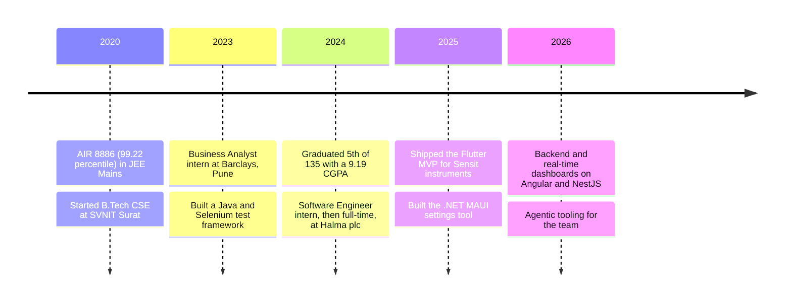
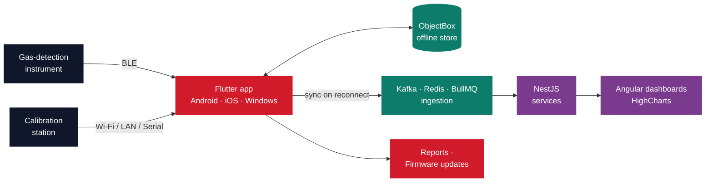
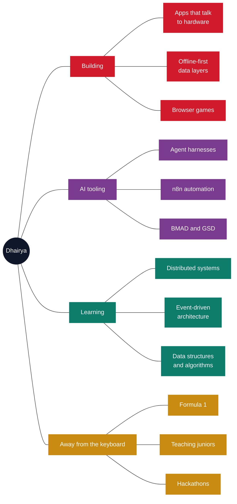

<!--
  Dhairya Oza · GitHub profile README
  Lives at github.com/Dhairya-007/Dhairya-007 — this file renders on the profile page.

  Palette (keep these consistent if you edit):
    deep navy  #10172A
    signal red #D11A2A
    teal       #0E7C6B

  THINGS TO FILL IN LATER
    - Push the Siddheshwari Investment source to a public repo and link it in the table.
    - Add a Writing section if you start posting.
    - Pin these six repos on your profile: detonator, portfolio, citrine-growth, DSA, GushWorks
      (profile → Customize your pins).
-->

  

  

  
  
  

## 👋 About me

I'm a Software Engineer at **Halma plc** in Ahmedabad, working on the software side of industrial gas detection. Most of what I build sits between an instrument and the cloud: a Flutter app that pairs with a gas detector over BLE, an offline-first store that survives a day in the field with no signal, and a sync layer that reconciles it all when the technician gets back into range.

I like the problems at that boundary. A dropped BLE packet, a calibration station that only speaks serial, a report that has to render identically on a phone and a Windows desktop — none of them are solved by a framework, and all of them are interesting.

I studied Computer Science at **SVNIT Surat**, graduating in 2024 ranked 5th of 135 with a 9.19 CGPA. Before Halma I spent a summer at **Barclays** in Pune building test automation.

## ⭐ What I work on

### 🧪 Cross-platform apps for Sensit gas-detection instruments

`Halma plc` &nbsp; `2024 – present` &nbsp; `Android · iOS · Windows`

The product line technicians use to pair with gas detectors, pull logs, run calibrations and generate reports. I led end-to-end development of the Flutter application and shipped its foundational MVP.

**What I built**

- A **multi-protocol connectivity layer**: BLE pairing and data exchange with Sensit instruments, plus Wi-Fi, LAN and serial communication with calibration stations — surfaced through device-scan, pairing and live connection-status screens.
- An **offline-first data layer** on ObjectBox with bidirectional cloud sync and automatic reconciliation on reconnect, so the app keeps working where connectivity does not.
- The **full application UI**: real-time data visualization, Gantt-chart timeline views, live streaming, interactive charts, and media capture with attachment sync.
- **Additional modules**: multi-template report generation with several summary formats, instrument firmware updates, device lifecycle management, and calibration-station workflows covering live monitoring, status, data download and on-device calibration.

**Stack:** Flutter · Dart · ObjectBox · BLE / Wi-Fi / LAN / Serial

### ⚙️ Instrument Settings application

`Halma plc` &nbsp; `.NET MAUI`

A guided desktop tool that lets technicians configure **~50 instrument parameters**, then packages the selections as byte arrays written to the instrument's Customer Profile region over BLE for automatic firmware setup. It removed **over 99%** of the manual configuration effort on the line.

### 🌐 Sensor data platform

`Halma plc` &nbsp; `Angular · NestJS`

Backend services and REST APIs for the web platform, built to ingest high-volume sensor data reliably.

- Integrated **Redis** caching, **Apache Kafka** event streaming and **BullMQ** job queues for the ingestion path.
- Built real-time **HighCharts** visualizations, including interactive wind-rose plots and correction dashboards.
- Containerized services with **Docker** and deployed on **Kubernetes** with CI/CD pipelines.
- Refactored data-intensive modules and optimized LiteDB queries in a legacy UWP desktop app, making reports and grids up to **75% faster**.

### 🤖 Internal automation and agentic tooling

`Halma plc`

Built internal automation on **n8n** plus a custom LLM agent harness, and researched agentic AI development frameworks (BMAD, GSD) to fold into the team's daily engineering workflow.

### 📱 React Native app for Sensit instruments

`Halma plc` &nbsp; `Android · iOS`

BLE data download, local persistence on SQLite and cloud sync from one shared codebase — about **40% less** development effort than building each platform separately.

### 🏦 Test automation at Barclays

`Barclays, Pune` &nbsp; `2023` &nbsp; `Business Analyst (BA4) Intern`

Engineered an automated testing framework with **Java** and **Selenium WebDriver** that raised coverage across critical workflows by **90%**, and wired it into **Jenkins** so tests ran on every commit.

## 🧪 Things I've built for myself

| Project | What it is | Built with | Links |
| --- | --- | --- | --- |
| **Detonate the Bomb** | A browser puzzle game: 50 hand-built levels of increasing difficulty, instruction-driven gameplay, timers, scoring and level progression. | Next.js · TypeScript · CSS3 | [Live](https://detonatebomb.netlify.app/) · [Code](https://github.com/Dhairya-007/detonator) |
| **Portfolio** | A single-page portfolio styled as a Formula 1 racing dashboard — 10+ custom animations, dynamic gauges, interactive navigation, responsive down to phone width. | Next.js · TypeScript · CSS animations | [Live](https://dhairyaoza007.netlify.app/) · [Code](https://github.com/Dhairya-007/portfolio) |
| **Siddheshwari Investment** | A business website for an investment firm: 10+ content sections covering services and financial products, tuned for load performance and cross-browser support. | Angular · TypeScript · Netlify | [Live](https://siddheshwariinvestment.netlify.app/) |
| **Citrine Growth** | A digital agency site with an admin panel and dual light/dark theming. | Next.js 14 · NestJS · Prisma · PostgreSQL | [Code](https://github.com/Dhairya-007/citrine-growth) |
| **DSA** | Where my data structures and algorithms practice lives. | Java | [Code](https://github.com/Dhairya-007/DSA) |

## 🗺️ How I got here

## 🔌 The shape of what I build

Most of my work is this path, end to end:

## 🧰 Tech I use

**Languages**

  

**Mobile and frontend**

  

React Native · .NET MAUI · ASP.NET · UWP · HighCharts

**Backend and data**

  

REST APIs · BullMQ · Microservices · Message queues · SQL Server · LiteDB · ObjectBox

**Cloud, DevOps and tools**

  

Azure DevOps · CI/CD · n8n

**AI and LLM work**

LLM APIs (Claude, OpenAI) · Prompt engineering · RAG and vector search · Agentic workflows · Custom agent harness · BMAD / GSD

## 🧠 What's on my mind

## 🌱 Right now

- 🔬 Going deeper on distributed systems — concurrency, scalability and fault tolerance, the parts that matter once sensor data arrives faster than one service can handle it.
- 🤖 Building agentic tooling into my daily workflow: n8n orchestration, a custom LLM agent harness, and frameworks like BMAD and GSD.
- 📱 Shipping new modules across the Flutter, .NET MAUI and React Native apps at Halma.
- 🧩 Keeping DSA sharp in [this repo](https://github.com/Dhairya-007/DSA).

## 🏆 Achievements

| | |
| --- | --- |
| 🎯 **JEE Mains 2020** | All India Rank **8886** — 99.22 percentile among 1.1 million candidates |
| 🎯 **JEE Advanced 2020** | All India Rank **~10,000** — 95+ percentile among 1.6 lakh candidates |
| 🎓 **SVNIT Surat, 2024** | Ranked **5th of 135** in B.Tech Computer Science and Engineering, 9.19/10 CGPA |
| 🧑‍🏫 **ACM NIT Surat** | Executive — organized hackathons and ran technical sessions for juniors |
| 💻 **MLSA NIT Surat** | Junior Developer — built event websites and supported technical events |

## 🤝 Let's talk

Happy to talk about cross-platform mobile, offline-first architecture, apps that speak BLE or serial to real hardware, or agentic AI in an engineering workflow.

📫 [ozadhairya73@gmail.com](mailto:ozadhairya73@gmail.com) · [LinkedIn](https://www.linkedin.com/in/dhairya-oza-7723b2200/) · [Portfolio](https://dhairyaoza007.netlify.app)

  

