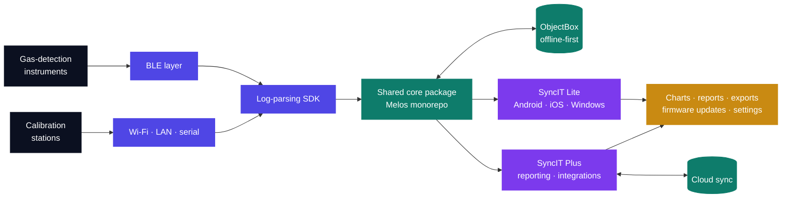
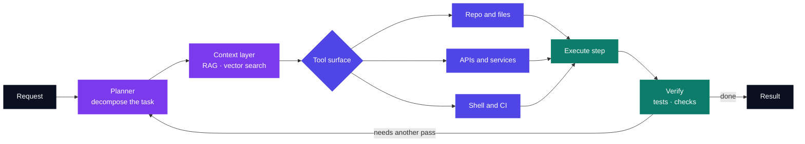
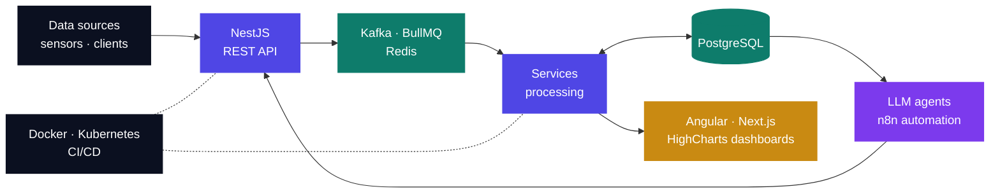
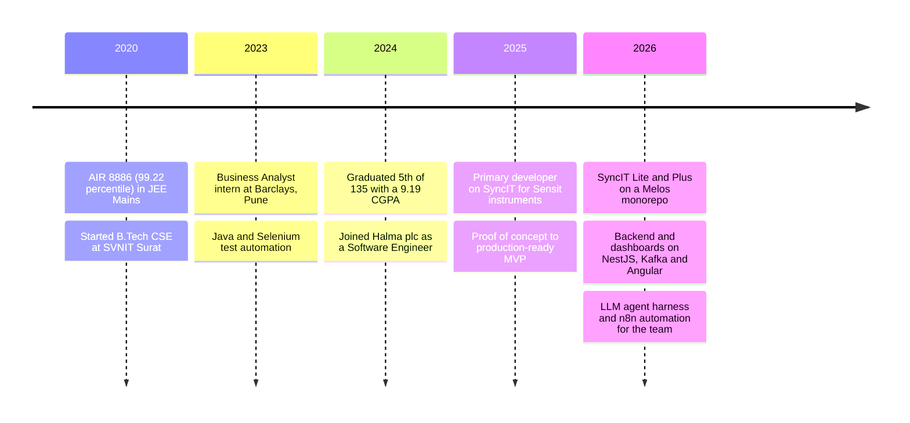
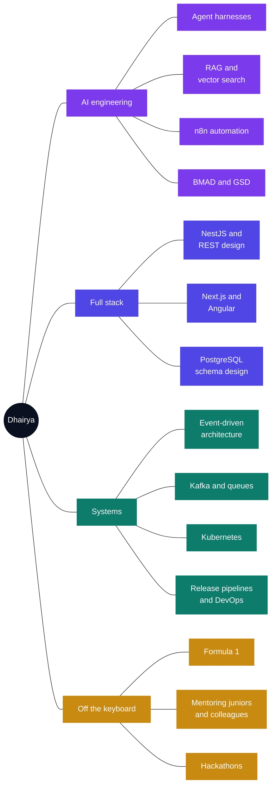

<!--
  Dhairya Oza · GitHub profile README
  Lives at github.com/Dhairya-007/Dhairya-007 — this file renders on the profile page.

  Positioning: full-stack engineer who builds AI into the stack.
  Frontend and backend lead; SyncIT (the cross-platform Sensit product) sits right after it.

  Palette (keep these consistent if you edit):
    deep navy #0B1020
    indigo    #4F46E5
    violet    #7C3AED
    teal      #0E7C6B

  THINGS TO FILL IN LATER
    - Push Siddheshwari Investment to a public repo and link it in the table.
    - Pin these six: agent-harness, rag-service, citrine-growth, detonator,
      portfolio, DSA (profile -> Customize your pins).
    - An n8n workflow pack would round out the AI section.
-->

  

  

  
  
  

---

## 👋 About me

I'm a **full-stack engineer** at **Halma plc**, building the whole path: PostgreSQL schemas and NestJS services at the back, Kafka and Redis in the middle, Angular and Next.js dashboards at the front, and Docker/Kubernetes underneath it all.

The half I'm most interested in right now is **AI in the engineering loop**. I've built a custom **LLM agent harness** and **n8n** automation that my team uses daily, and I work with RAG, vector search and agentic frameworks like BMAD and GSD. Not models — systems: the orchestration, the tool layer, the retrieval, and the glue that makes an agent useful instead of impressive.

The other half of my work is hardware-facing. I'm the primary developer on **SyncIT**, the application that manages Sensit's gas-detection instruments over BLE, Wi-Fi, LAN and serial, on Android, iOS and Windows from one Flutter codebase.

I also mentor juniors and colleagues on the codebase, and work with the project manager and engineering manager in **Wrike** on task breakdown, sizing and distribution.

I studied Computer Science at **SVNIT Surat**, graduating in 2024 ranked 5th of 135 with a 9.19 CGPA.

  
  
  
  
  
  

---

## 🏗️ Full-stack engineering

### 🌐 Sensor data platform · `Angular` `NestJS` `PostgreSQL` `Kafka`

`Halma plc` &nbsp; `2024 – present`

A platform that ingests high-volume sensor data and puts it in front of customers as live dashboards. I work across the whole stack on it.

**Backend**
- Engineered the **REST API surface** and backend services on **NestJS**.
- Built the ingestion path with **Apache Kafka** event streaming, **Redis** caching and **BullMQ** job queues, so high-volume sensor data lands reliably instead of dropping under burst load.
- Designed for scale and fault tolerance — the data arrives faster than any single service wants to handle.

**Frontend**
- Built real-time **HighCharts** visualizations on Angular, including interactive **wind-rose plots** and correction dashboards, so customers can read live field data at a glance.

**Infrastructure**
- Containerized services with **Docker**, deployed on **Kubernetes**, and wired up **CI/CD pipelines** for scalable, fault-tolerant releases.

**Performance**
- Refactored data-intensive modules and optimized LiteDB queries in a legacy UWP desktop app — reports and grids load up to **75% faster**.

---

## 📱 SyncIT · instrument management platform

### 🛰️ Cross-platform product for gas-detection instruments · `Flutter` `Dart` `Melos` `ObjectBox`

`Sensit Technologies · Halma India` &nbsp; `2025 – present` &nbsp; `Android · iOS · Windows`

  
  
  
  
  
  

  
  
  
  

<table>
  <tr>
    <td align="center"><b>−99%</b> manual production effort removed</td>
    <td align="center"><b>30–35%</b> faster after schema and query work</td>
    <td align="center"><b>50</b> instrument settings pushed automatically</td>
    <td align="center"><b>4</b> transports: BLE, Wi-Fi LAN, serial</td>
    <td align="center"><b>3</b> platforms from one codebase</td>
    <td align="center"><b>5</b> older apps merged into SyncIT Lite and Plus</td>
    <td align="center"><b>25–30</b> person team across 3 countries</td>
  </tr>
</table>

[Sensit](https://sensit-tech.com/gas-leak-detection-software/) has made gas-detection instruments for utilities, firefighters and hazmat teams for over 40 years. **SyncIT** is its next-generation instrument management platform. It retired **5 older Sensit apps**, with all their functions consolidated into SyncIT Lite and SyncIT Plus.

I'm the **primary developer** on it, working with a **25–30 person team** across software, firmware, hardware, QA, project management and marketing, split between **Ahmedabad**, **Valparaiso (Indiana)** and **Bolzano (Italy)**.

**What I did**

- Took SyncIT from a **proof of concept to a production-ready MVP**, and have kept evolving it since through new features, architectural improvements and client-driven changes.
- **Retired 5 older apps** and moved all their functions into SyncIT Lite and Plus.
- Structured it as a **Melos monorepo** with two product variants on a shared core package and a dedicated **log-parsing SDK**.
- Built the **device communication modules** — **BLE** for gas-detection instruments, and **Wi-Fi, LAN and serial** for calibration stations — covering log download, parsing, visualization, firmware update workflows and multi-format export.
- Suggested and built a **settings application for three instruments**, with an automated BLE update flow across **50 settings**. Working with the firmware team, this cut manual production effort by about **99%**.
- **Performance:** improved app performance by about **30–35%** by optimizing the database schema and queries.
- **Robustness:** built the **offline-first ObjectBox store** with bidirectional cloud sync and automatic reconciliation on reconnect, for reliable operation in low-connectivity field environments.
- Built the data-heavy screens on top of it: real-time charts, Gantt timeline views and multi-template report generation.
- Reworked the app's **UI, navigation flow and data visualization**, creating the wireframes with the engineering manager.
- Built **Windows-scheduled reporting** for LAN-connected devices, with customizable export configurations.
- **Own the full release pipeline**: build generation, versioning, packaging and distribution on every platform.

**Beyond the code**

I joined Halma as an intern in January 2024 and have been the primary developer on SyncIT since 2025.

- **Spotted a production bottleneck and removed it.** I proposed the settings application and built it with the firmware team. Manual production effort dropped by about **99%**.
- **Own releases on 3 platforms.** Builds, versioning, packaging and distribution for Android, iOS and Windows, with **Azure DevOps** in the toolchain.
- **Primary developer for a 25–30 person team.** That means working with **6 disciplines in 3 countries**: software, firmware, hardware, QA, project management and marketing.
- **Keep delivery organised in Wrike.** I create tasks, size them, distribute them across the team and track them through to release.
- **Mentor juniors and colleagues** on the codebase and help them get unblocked.
- **Brought agentic tooling into daily engineering.** I built a custom LLM agent harness and **n8n** automation for the team, and integrated **BMAD** and **GSD** into its workflow.

| Variant | What it is |
| --- | --- |
| **SyncIT Lite** | Offline-first, for field evaluation |
| **SyncIT Plus** | Cloud sync, advanced reporting and premium integrations |

**Stack:** Flutter · Dart · Melos · ObjectBox · BLE · Wi-Fi, LAN and serial · Azure DevOps CI/CD · Wrike · n8n · Claude Code

  
  
  
  
  

---

## 🤖 AI and agentic engineering

### 🧠 LLM agent harness and workflow automation

`Halma plc`

The part of my work I'd happily talk about all day. I build the systems around models, not the models themselves.

- Built a **custom LLM agent harness** for internal use — the orchestration layer that gives a model a tool surface, a context budget and a place to fail safely.
- Built internal automation on **n8n** workflow orchestration, wiring engineering tasks into repeatable pipelines.
- Researched and integrated **agentic AI development frameworks** — **BMAD** and **GSD** — into the team's daily engineering workflow.

**What I work with:** LLM APIs (Claude, OpenAI) · prompt engineering · **RAG** · vector search · agentic workflows · tool/function calling · n8n

  
  
  
  
  

### 📦 Open source

The work above lives in a private codebase, so here are the same ideas, in public and runnable.

| Repo | What it is | Built with |
| --- | --- | --- |
| **[agent-harness](https://github.com/Dhairya-007/agent-harness)** | A typed agent harness for Claude. The loop is the easy part — this is the rest: tool inputs validated before they run, approval gates over parsed arguments, a context budget that clears old tool output, a verification pass that can send the model back, and distinct errors for refusal, truncated tool input and context overflow. 39 tests, no network. | TypeScript · Zod · Anthropic SDK |
| **[rag-service](https://github.com/Dhairya-007/rag-service)** | Grounded document Q&A. Hybrid BM25 + dense retrieval fused by rank, a NestJS API and a Next.js UI. Retrieval is a *tool the model calls repeatedly*, not a prompt prefix, and an answer that cites nothing is rejected and sent back. 52 tests. | NestJS · Next.js · TypeScript · agent-harness |

### How I think about agent systems

---

## 🧩 Full-stack projects

| Project | What it is | Stack | Links |
| --- | --- | --- | --- |
| **rag-service** | Grounded document Q&A — hybrid retrieval, a NestJS API and a Next.js UI, with answers that cite their sources. | NestJS · Next.js · TypeScript | [Code](https://github.com/Dhairya-007/rag-service) |
| **agent-harness** | A typed agent harness for Claude: validated tool inputs, approval gates, context budgeting and a readable trace. | TypeScript · Zod · Anthropic SDK | [Code](https://github.com/Dhairya-007/agent-harness) |
| **Citrine Growth** | A digital agency platform — marketing site plus a full admin panel, with dual light/dark theming throughout. | Next.js 14 · NestJS · Prisma · PostgreSQL | [Code](https://github.com/Dhairya-007/citrine-growth) |
| **Detonate the Bomb** | A browser puzzle game: 50 hand-built levels, instruction-driven gameplay, timer system, scoring and level progression, all client-side. | Next.js · TypeScript · CSS3 | [Live](https://detonatebomb.netlify.app/) · [Code](https://github.com/Dhairya-007/detonator) |
| **Portfolio** | A single-page portfolio built as a Formula 1 racing dashboard — 10+ custom animations, dynamic gauges, interactive navigation, responsive to phone width. | Next.js · TypeScript · CSS animations | [Live](https://dhairyaoza007.netlify.app/) · [Code](https://github.com/Dhairya-007/portfolio) |
| **Siddheshwari Investment** | A business site for an investment firm: 10+ content sections, tuned for load performance and cross-browser support. | Angular · TypeScript · Netlify | [Live](https://siddheshwariinvestment.netlify.app/) |
| **DSA** | Where my data structures and algorithms practice lives. | Java | [Code](https://github.com/Dhairya-007/DSA) |

---

## 🔌 The shape of what I build

End to end, most of my work is this path:

---

## 📱 Other instrument clients at Halma

Two more clients for the same instruments:

- **.NET MAUI settings application** — the app behind the 99% figure above. It configures ~50 instrument parameters through a guided UI, packaged as byte arrays and written to the instrument's Customer Profile region over BLE.
- **React Native app** — BLE data download, SQLite persistence and cloud sync across Android and iOS from one shared codebase, **40% less** development effort.

---

## 🏦 Before Halma: test automation at Barclays

`Business Analyst (BA4) Intern` &nbsp; `Pune, 2023`

Built an automated testing framework with **Java** and **Selenium WebDriver** that raised coverage across critical workflows by **90%**, and wired it into **Jenkins** to run on every commit.

---

## 🧰 Tech I use

**Frontend**

  

HighCharts · Flutter · React Native · .NET MAUI · Responsive and cross-browser work

**Backend**

  

REST APIs · Microservices · Message queues · BullMQ · ASP.NET

**Data and messaging**

  

SQL Server · LiteDB · ObjectBox · Vector search · Melos monorepos

**AI and LLM**

  
  
  

Agent harness · RAG · Vector search · Prompt engineering · Tool calling · BMAD / GSD

**Cloud and DevOps**

  

Azure DevOps · CI/CD · Multi-platform release pipelines (Android, iOS, Windows) · Wrike · Task planning and distribution

---

## 🗺️ How I got here

---

## 🧠 What's on my mind

---

## 🌱 Right now

- 🤖 **Building agentic tooling into daily engineering.** n8n orchestration, a custom LLM agent harness, and frameworks like BMAD and GSD — the goal is an agent that reliably finishes a task, not one that demos well.
- 🔍 **Going deeper on RAG and retrieval.** Chunking strategies, hybrid search and rank fusion, and how much context is actually worth paying for — most of it ends up in [rag-service](https://github.com/Dhairya-007/rag-service).
- 📡 **Growing SyncIT past its MVP.** Two product variants on one Melos monorepo, a shared core package, a log-parsing SDK, and the device communication layer underneath both.
- ⚙️ **Scaling the backend.** Event-driven architecture, concurrency and fault tolerance, for when sensor data arrives faster than one service can handle.
- 🧩 **Keeping fundamentals sharp** in [my DSA repo](https://github.com/Dhairya-007/DSA).

---

## 🏆 Achievements

| | |
| --- | --- |
| 🎯 **JEE Mains 2020** | All India Rank **8886** — 99.22 percentile among 1.1 million candidates |
| 🎯 **JEE Advanced 2020** | All India Rank **~10,000** — 95+ percentile among 1.6 lakh candidates |
| 🎓 **SVNIT Surat, 2024** | Ranked **5th of 135** in B.Tech Computer Science and Engineering, 9.19/10 CGPA |
| 🧑‍🏫 **ACM NIT Surat** | Executive — organized hackathons and ran technical sessions for juniors |
| 💻 **MLSA NIT Surat** | Junior Developer — built event websites and supported technical events |

---

## 🤝 Let's talk

Happy to talk about full-stack architecture, event-driven backends, or putting LLM agents somewhere they actually earn their keep.

📫 [ozadhairya73@gmail.com](mailto:ozadhairya73@gmail.com) · [LinkedIn](https://www.linkedin.com/in/dhairya-oza-7723b2200/) · [Portfolio](https://dhairyaoza007.netlify.app)

  

