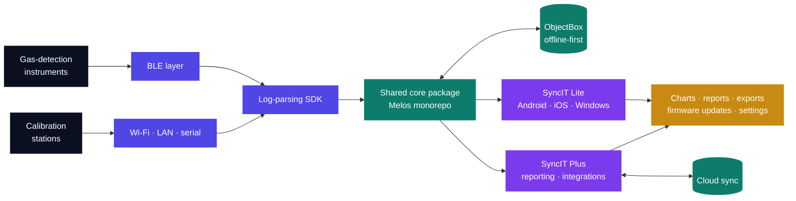
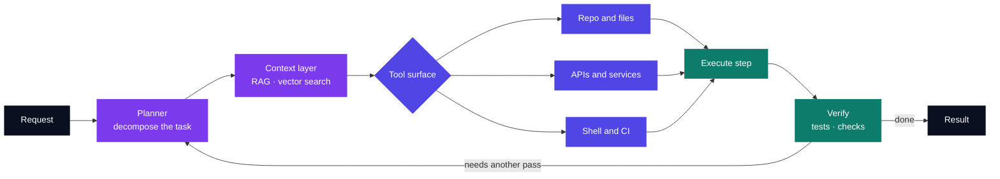
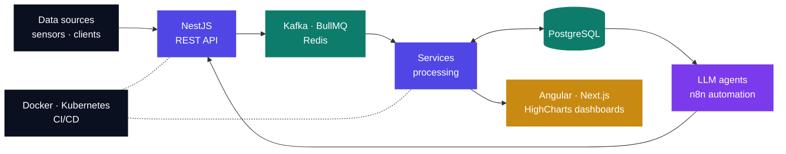
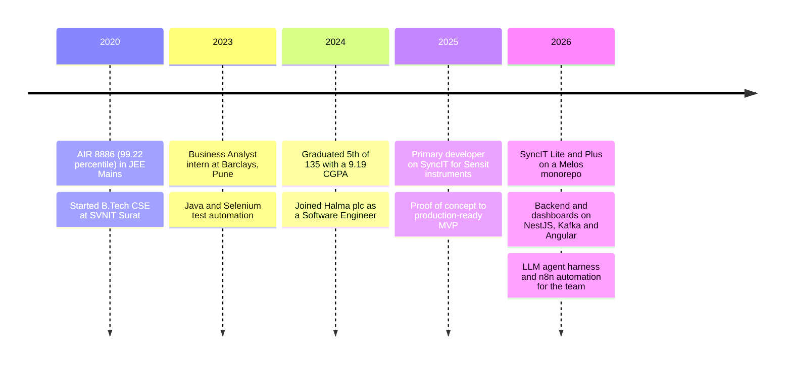
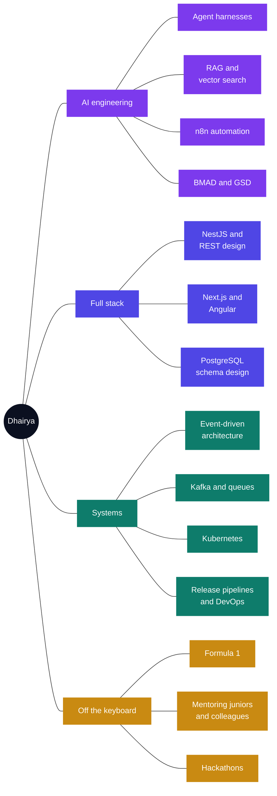

<!--
  Dhairya Oza · GitHub profile README
  Lives at github.com/Dhairya-007/Dhairya-007 — this file renders on the profile page.

  Positioning, in priority order:
    1. Upstream contributor — 142 changes merged into Apache Camel, Elasticsearch,
       Netty, Quarkus, Micronaut, Home Assistant, typeshed, the PEPs and Google's
       Dart repos. This is the rarest thing here, so it leads.
    2. Maintainer — lattice (Flutter data grid, on pub.dev) and datagrid-core.
    3. Primary developer on SyncIT at Halma.
    4. Everything else.

  Palette (keep these consistent if you edit):
    deep navy #0B1020
    indigo    #4F46E5
    violet    #7C3AED
    teal      #0E7C6B

  MAINTENANCE
    - PR counts are live-verifiable:
        merged:    gh api -X GET search/issues -f q='author:Dhairya-007 type:pr is:merged' --paginate
        in review: gh api -X GET search/issues -f q='author:Dhairya-007 type:pr is:open'   --paginate
      Exclude repos under Dhairya-007/ — only upstream counts. Update the "as of" date.
    - Pin these six: lattice, agent-harness, rag-service, datagrid-core,
      voiceagent, lights-out (profile -> Customize your pins).
    - Add the lattice web demo link here once GitHub Pages is live.
-->

  

  

  
  
  
  

<table align="center">
  <tr>
    <td align="center" width="25%"><b>142</b> changes merged into upstream projects</td>
    <td align="center" width="25%"><b>12</b> projects, incl. Apache Python, Netty, Google</td>
    <td align="center" width="25%"><b>2</b> open-source libraries published and maintained</td>
    <td align="center" width="25%"><b>3</b> platforms I ship a product on</td>
  </tr>
</table>

> **The short version.** I'm a full-stack engineer at Halma plc, and in my own time I hunt one class of bug on purpose: the kind a project's CI **structurally cannot catch**. A default hidden behind `**kwargs` that `stubtest` has no parameter to compare against. A log line whose placeholders outnumber its arguments. A hand-written catalog entry that drifts from the enum it describes. A format string that throws the moment debug logging is switched on. Linters do not look there, so the defects sit in released code for years. **142 of those are now fixed in Apache Camel, Elasticsearch, Netty, Quarkus, Home Assistant and friends.**

---

## 🌍 Upstream contributions

  
  
  

Every typing change is verified the same way before it goes out: `stubtest` against the real installed package, then `mypy --strict` and `pyright` on a usage file full of `assert_type`, so the error count before and after is the evidence. I only count a change once maintainers merge it.

### 📦 By project

| Project | Merged | In review |
| --- | ---: | ---: |
| [Apache Camel](https://github.com/apache/camel/pulls?q=is%3Apr+author%3ADhairya-007) | 120 | — |
| [drift](https://github.com/simolus3/drift/pulls?q=is%3Apr+author%3ADhairya-007) | 5 | — |
| [typeshed](https://github.com/python/typeshed/pulls?q=is%3Apr+author%3ADhairya-007) | 4 | 4 |
| [the PEPs](https://github.com/python/peps/pulls?q=is%3Apr+author%3ADhairya-007) | 3 | — |
| [Netty](https://github.com/netty/netty/pulls?q=is%3Apr+author%3ADhairya-007) | 2 | — |
| [Micronaut](https://github.com/micronaut-projects/micronaut-core/pulls?q=is%3Apr+author%3ADhairya-007) | 2 | 2 |
| [Elasticsearch](https://github.com/elastic/elasticsearch/pulls?q=is%3Apr+author%3ADhairya-007) | 1 | 1 |
| [more-itertools](https://github.com/more-itertools/more-itertools/pulls?q=is%3Apr+author%3ADhairya-007) | 1 | 1 |
| [shelf](https://github.com/dart-lang/shelf/pulls?q=is%3Apr+author%3ADhairya-007) | 1 | 1 |
| [Quarkus](https://github.com/quarkusio/quarkus/pulls?q=is%3Apr+author%3ADhairya-007) | 1 | — |
| [Home Assistant](https://github.com/home-assistant/core/pulls?q=is%3Apr+author%3ADhairya-007) | 1 | — |
| [native](https://github.com/dart-lang/native/pulls?q=is%3Apr+author%3ADhairya-007) | 1 | — |
| [CPython](https://github.com/python/cpython/pulls?q=is%3Apr+author%3ADhairya-007) | — | 1 |
| [better-ajv-errors](https://github.com/atlassian/better-ajv-errors/pulls?q=is%3Apr+author%3ADhairya-007) | — | 2 |
| [eslint-plugin-vitest](https://github.com/vitest-dev/eslint-plugin-vitest/pulls?q=is%3Apr+author%3ADhairya-007) | — | 2 |
| [intl (dart-lang/i18n)](https://github.com/dart-lang/i18n/pulls?q=is%3Apr+author%3ADhairya-007) | — | 1 |
| [dart-lang/tools](https://github.com/dart-lang/tools/pulls?q=is%3Apr+author%3ADhairya-007) | — | 1 |
| **Total** | **142** | **16** |

Every PR is public and verifiable: [all merged](https://github.com/search?q=author%3ADhairya-007+is%3Apr+is%3Amerged+-user%3ADhairya-007&type=pullrequests) · [all in review](https://github.com/search?q=author%3ADhairya-007+is%3Apr+is%3Aopen+-user%3ADhairya-007&type=pullrequests). Counts as of **25 Nov 2026**.

---

## 📦 Open source I maintain

Libraries I build and keep, not demos. Both grid projects exist for the same reason: every capable data grid in their ecosystem is behind a licence key.

### 🧮 [lattice](https://github.com/Dhairya-007/lattice) · a data grid for Flutter that doesn't ask for a licence key

  
  
  
  

Flutter's data grid story is Syncfusion and friends — powerful, and gated behind a paid licence. **lattice** does the hard parts and asks for nothing: frozen columns, multi-column sorting, a filter row, grouping with subtotals, tree rows, virtual scrolling, range selection, inline editing and CSV export. No licence key, no paid tier, no evaluation banner.

**[pub.dev](https://pub.dev/packages/lattice_core)** · **[Code](https://github.com/Dhairya-007/lattice)** · MIT

### ⚙️ [datagrid-core](https://github.com/Dhairya-007/datagrid-core) · the same engine, headless, for TypeScript

Sorting, filtering, grouping with aggregates, tree rows, virtualization, selection, editing with undo and CSV export — as a pure state machine. No renderer, no framework, **no dependencies**. Bring your own React, Vue, Svelte or plain DOM.

### 🤖 The AI work, in public

The agent systems I build at work live in a private codebase, so here are the same ideas, runnable.

| Repo | What it is | Built with |
| --- | --- | --- |
| **[agent-harness](https://github.com/Dhairya-007/agent-harness)** | A typed agent harness for Claude. The loop is the easy part — this is the rest: tool inputs validated before they run, approval gates over parsed arguments, a context budget that clears old tool output, a verification pass that can send the model back, and distinct errors for refusal, truncated tool input and context overflow. **39 tests, no network.** | TypeScript · Zod · Anthropic SDK |
| **[rag-service](https://github.com/Dhairya-007/rag-service)** | Grounded document Q&A. Hybrid BM25 + dense retrieval fused by rank, a NestJS API and a Next.js UI. Retrieval is a *tool the model calls repeatedly*, not a prompt prefix, and an answer that cites nothing is rejected and sent back. **52 tests.** | NestJS · Next.js · TypeScript · agent-harness |
| **[voiceagent](https://github.com/Dhairya-007/voiceagent)** | Streaming voice agent for phone calls: STT → LLM → TTS with barge-in, Twilio telephony and per-turn latency tracing. **696 ms p50.** Runs free and offline. | Python · Twilio · streaming STT/TTS |

---

## 👋 About me

I'm a **full-stack engineer** at **Halma plc**, building the whole path: PostgreSQL schemas and NestJS services at the back, Kafka and Redis in the middle, Angular and Next.js dashboards at the front, and Docker/Kubernetes underneath it all.

Outside of work, I do two things. I **contribute upstream** — 142 changes merged into Apache Camel, Elasticsearch, Netty, Quarkus, Home Assistant and the Python and Dart ecosystems, all of one kind: the defect a project's own tooling cannot see. And I **maintain libraries** that fill a gap I hit myself — [lattice](https://github.com/Dhairya-007/lattice), a data grid for Flutter that doesn't need a licence key, and [datagrid-core](https://github.com/Dhairya-007/datagrid-core), the same engine headless for TypeScript.

The half of my day job I'm most interested in is **AI in the engineering loop**. I've built a custom **LLM agent harness** and **n8n** automation that my team uses daily, and I work with RAG, vector search and agentic frameworks like BMAD and GSD. Not models — systems: the orchestration, the tool layer, the retrieval, and the glue that makes an agent useful instead of impressive.

The other half is hardware-facing. I'm the primary developer on **SyncIT**, the application that manages Sensit's gas-detection instruments over BLE, Wi-Fi, LAN and serial, on Android, iOS and Windows from one Flutter codebase.

I also mentor juniors and colleagues on the codebase, and work with the project manager and engineering manager in **Wrike** on task breakdown, sizing and distribution.

  
  
  
  
  
  
  

---
## 📱 SyncIT · instrument management platform

### 🛰️ Cross-platform product for gas-detection instruments · `Flutter` `Dart` `Melos` `ObjectBox`

`Sensit Technologies · Halma India` &nbsp; `2025 – present` &nbsp; `Android · iOS · Windows`

  
  
  
  
  
  

  
  
  
  

<table>
  <tr>
    <td align="center"><b>−99%</b> manual production effort removed</td>
    <td align="center"><b>30–35%</b> faster after schema and query work</td>
    <td align="center"><b>50</b> instrument settings pushed automatically</td>
    <td align="center"><b>4</b> transports: BLE, Wi-Fi LAN, serial</td>
    <td align="center"><b>3</b> platforms from one codebase</td>
    <td align="center"><b>5</b> older apps merged into SyncIT Lite and Plus</td>
    <td align="center"><b>25–30</b> person team across 3 countries</td>
  </tr>
</table>

[Sensit](https://sensit-tech.com/gas-leak-detection-software/) has made gas-detection instruments for utilities, firefighters and hazmat teams for over 40 years. **SyncIT** is its next-generation instrument management platform. It retired **5 older Sensit apps**, with all their functions consolidated into SyncIT Lite and SyncIT Plus.

I'm the **primary developer** on it, working with a **25–30 person team** across software, firmware, hardware, QA, project management and marketing, split between **Ahmedabad**, **Valparaiso (Indiana)** and **Bolzano (Italy)**.

**What I did**

- Took SyncIT from a **proof of concept to a production-ready MVP**, and have kept evolving it since through new features, architectural improvements and client-driven changes.
- **Retired 5 older apps** and moved all their functions into SyncIT Lite and Plus.
- Structured it as a **Melos monorepo** with two product variants on a shared core package and a dedicated **log-parsing SDK**.
- Built the **device communication modules** — **BLE** for gas-detection instruments, and **Wi-Fi, LAN and serial** for calibration stations — covering log download, parsing, visualization, firmware update workflows and multi-format export.
- Suggested and built a **settings application for three instruments**, with an automated BLE update flow across **50 settings**. Working with the firmware team, this cut manual production effort by about **99%**.
- **Performance:** improved app performance by about **30–35%** by optimizing the database schema and queries.
- **Robustness:** built the **offline-first ObjectBox store** with bidirectional cloud sync and automatic reconciliation on reconnect, for reliable operation in low-connectivity field environments.
- Built the data-heavy screens on top of it: real-time charts, Gantt timeline views and multi-template report generation.
- Reworked the app's **UI, navigation flow and data visualization**, creating the wireframes with the engineering manager.
- Built **Windows-scheduled reporting** for LAN-connected devices, with customizable export configurations.
- **Own the full release pipeline**: build generation, versioning, packaging and distribution on every platform.

**Beyond the code**

I joined Halma as an intern in January 2024 and have been the primary developer on SyncIT since 2025.

- **Spotted a production bottleneck and removed it.** I proposed the settings application and built it with the firmware team. Manual production effort dropped by about **99%**.
- **Own releases on 3 platforms.** Builds, versioning, packaging and distribution for Android, iOS and Windows, with **Azure DevOps** in the toolchain.
- **Primary developer for a 25–30 person team.** That means working with **6 disciplines in 3 countries**: software, firmware, hardware, QA, project management and marketing.
- **Keep delivery organised in Wrike.** I create tasks, size them, distribute them across the team and track them through to release.
- **Mentor juniors and colleagues** on the codebase and help them get unblocked.
- **Brought agentic tooling into daily engineering.** I built a custom LLM agent harness and **n8n** automation for the team, and integrated **BMAD** and **GSD** into its workflow.

| Variant | What it is |
| --- | --- |
| **SyncIT Lite** | Offline-first, for field evaluation |
| **SyncIT Plus** | Cloud sync, advanced reporting and premium integrations |

**Stack:** Flutter · Dart · Melos · ObjectBox · BLE · Wi-Fi, LAN and serial · Azure DevOps CI/CD · Wrike · n8n · Claude Code

  
  
  
  
  

---

## 🏗️ Full-stack engineering

### 🌐 Sensor data platform · `Angular` `NestJS` `PostgreSQL` `Kafka`

`Halma plc` &nbsp; `2024 – present`

A platform that ingests high-volume sensor data and puts it in front of customers as live dashboards. I work across the whole stack on it.

**Backend**
- Engineered the **REST API surface** and backend services on **NestJS**.
- Built the ingestion path with **Apache Kafka** event streaming, **Redis** caching and **BullMQ** job queues, so high-volume sensor data lands reliably instead of dropping under burst load.
- Designed for scale and fault tolerance — the data arrives faster than any single service wants to handle.

**Frontend**
- Built real-time **HighCharts** visualizations on Angular, including interactive **wind-rose plots** and correction dashboards, so customers can read live field data at a glance.

**Infrastructure**
- Containerized services with **Docker**, deployed on **Kubernetes**, and wired up **CI/CD pipelines** for scalable, fault-tolerant releases.

**Performance**
- Refactored data-intensive modules and optimized LiteDB queries in a legacy UWP desktop app — reports and grids load up to **75% faster**.

---

## 🤖 AI and agentic engineering

### 🧠 LLM agent harness and workflow automation

`Halma plc`

The part of my work I'd happily talk about all day. I build the systems around models, not the models themselves.

- Built a **custom LLM agent harness** for internal use — the orchestration layer that gives a model a tool surface, a context budget and a place to fail safely.
- Built internal automation on **n8n** workflow orchestration, wiring engineering tasks into repeatable pipelines.
- Researched and integrated **agentic AI development frameworks** — **BMAD** and **GSD** — into the team's daily engineering workflow.

**What I work with:** LLM APIs (Claude, OpenAI) · prompt engineering · **RAG** · vector search · agentic workflows · tool/function calling · n8n

  
  
  
  
  

### How I think about agent systems

---

## 🧩 Things I've built for fun

| Project | What it is | Stack | Links |
| --- | --- | --- | --- |
| **lights-out** | Formula 1 races replayed in the browser in 3D, with real engine sound, team radio, and the race story found automatically from timing data. | Three.js · Web Audio · OpenF1 | [Live](https://dhairya-007.github.io/lights-out/) · [Code](https://github.com/Dhairya-007/lights-out) |
| **billber** | Split shared expenses in three taps. No account, no server, works offline. | TypeScript · PWA | [Code](https://github.com/Dhairya-007/billber) |
| **ochre-pass-rally** | A 3D rally game in Python: career mode, AI rivals, online multiplayer, four generated stages, physically based rendering. | Python · Panda3D | [Code](https://github.com/Dhairya-007/ochre-pass-rally) |
| **Detonate the Bomb** | A browser puzzle game: 50 hand-built levels, instruction-driven gameplay, timer, scoring and level progression, all client-side. | Next.js · TypeScript · CSS3 | [Live](https://detonatebomb.netlify.app/) · [Code](https://github.com/Dhairya-007/detonator) |
| **Portfolio** | A single-page portfolio built as a Formula 1 racing dashboard — 10+ custom animations, dynamic gauges, interactive navigation, responsive to phone width. | Next.js · TypeScript · CSS animations | [Live](https://dhairyaoza007.netlify.app/) · [Code](https://github.com/Dhairya-007/portfolio) |
| **Citrine Growth** | A digital agency platform — marketing site plus a full admin panel, with dual light/dark theming throughout. | Next.js 14 · NestJS · Prisma · PostgreSQL | [Code](https://github.com/Dhairya-007/citrine-growth) |
| **Siddheshwari Investment** | A business site for an investment firm: 10+ content sections, tuned for load performance and cross-browser support. | Angular · TypeScript · Netlify | [Live](https://siddheshwariinvestment.netlify.app/) |
| **Desi board games** | Ludo with cuts and safe stars, snakes and ladders with hand-drawn SVG snakes and a 3D dice, and an Ahmedabad property board game. | React · Vite · SVG | [ludo](https://github.com/Dhairya-007/ludo-katta) · [saap-sidi](https://github.com/Dhairya-007/saap-sidi) · [amdavad](https://github.com/Dhairya-007/amdavad-business) |

---
## 🔌 The shape of what I build

End to end, most of my work is this path:

---

## 📱 Other instrument clients at Halma

Two more clients for the same instruments:

- **.NET MAUI settings application** — the app behind the 99% figure above. It configures ~50 instrument parameters through a guided UI, packaged as byte arrays and written to the instrument's Customer Profile region over BLE.
- **React Native app** — BLE data download, SQLite persistence and cloud sync across Android and iOS from one shared codebase, **40% less** development effort.

---

## 🏦 Before Halma: test automation at Barclays

`Business Analyst (BA4) Intern` &nbsp; `Pune, 2023`

Built an automated testing framework with **Java** and **Selenium WebDriver** that raised coverage across critical workflows by **90%**, and wired it into **Jenkins** to run on every commit.

---

## 🧰 Tech I use

**Frontend**

  

HighCharts · Flutter · React Native · .NET MAUI · Responsive and cross-browser work

**Backend**

  

REST APIs · Microservices · Message queues · BullMQ · ASP.NET

**Data and messaging**

  

SQL Server · LiteDB · ObjectBox · Vector search · Melos monorepos

**AI and LLM**

  
  
  

Agent harness · RAG · Vector search · Prompt engineering · Tool calling · BMAD / GSD

**Cloud and DevOps**

  

Azure DevOps · CI/CD · Multi-platform release pipelines (Android, iOS, Windows) · Wrike · Task planning and distribution

---

## 🗺️ How I got here

---

## 🧠 What's on my mind

---

## 🌱 Right now

- 🧮 **Growing [lattice](https://github.com/Dhairya-007/lattice) past 1.0.** A web demo, more grid features, and the long tail of things people actually need from a data grid once they start using it in anger.
- 🌍 **Contributing upstream, one CI blind spot at a time.** 142 changes merged into Apache Camel, Elasticsearch, Quarkus, Home Assistant, typeshed, the PEPs, Netty, Micronaut, more-itertools, drift and the Dart SDK repos — each one a defect the project's own linters and test suites could not reach — and 16 more in review.
- 🤖 **Building agentic tooling into daily engineering.** n8n orchestration, a custom LLM agent harness, and frameworks like BMAD and GSD — the goal is an agent that reliably finishes a task, not one that demos well.
- 🔍 **Going deeper on RAG and retrieval.** Chunking strategies, hybrid search and rank fusion, and how much context is actually worth paying for — most of it ends up in [rag-service](https://github.com/Dhairya-007/rag-service).
- 📡 **Growing SyncIT past its MVP.** Two product variants on one Melos monorepo, a shared core package, a log-parsing SDK, and the device communication layer underneath both.
- ⚙️ **Scaling the backend.** Event-driven architecture, concurrency and fault tolerance, for when sensor data arrives faster than one service can handle.

---

## 📊 GitHub activity

  
  

---

## 🏆 Background

| | |
| --- | --- |
| 🎓 **SVNIT Surat, 2024** | B.Tech Computer Science — ranked **5th of 135**, 9.19/10 CGPA |
| 🧑‍🏫 **ACM NIT Surat** | Executive — organized hackathons and ran technical sessions for juniors |
| 💻 **MLSA NIT Surat** | Junior Developer — built event websites and supported technical events |

---
## 🤝 Let's talk

Happy to talk about full-stack architecture, event-driven backends, or putting LLM agents somewhere they actually earn their keep.

📫 [ozadhairya73@gmail.com](mailto:ozadhairya73@gmail.com) · [LinkedIn](https://www.linkedin.com/in/dhairya-oza-7723b2200/) · [Portfolio](https://dhairyaoza007.netlify.app)

  

